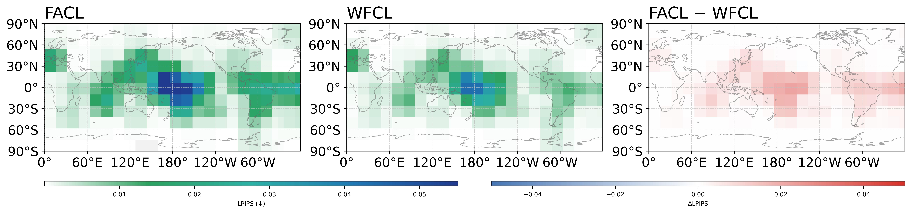
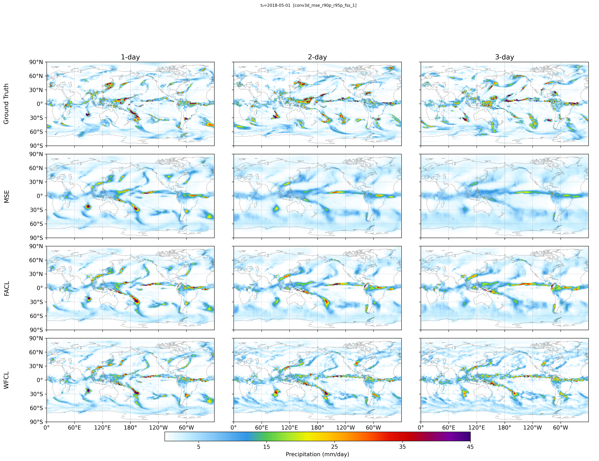
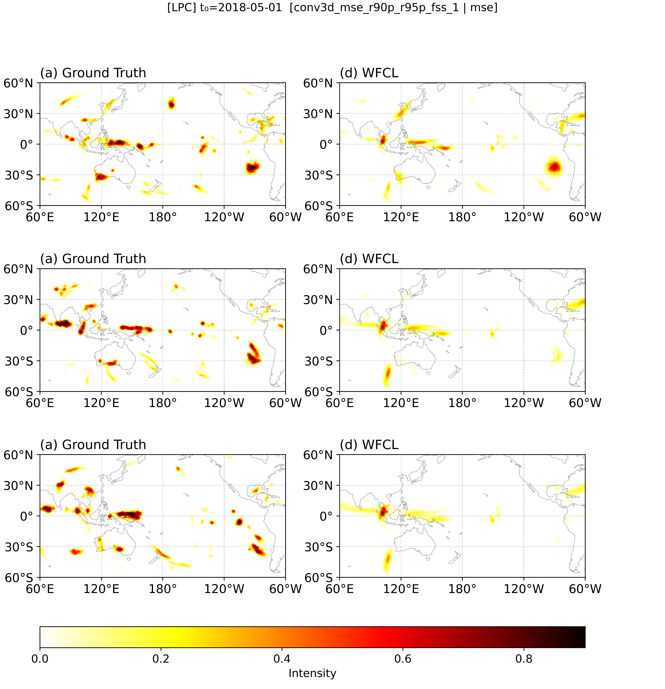
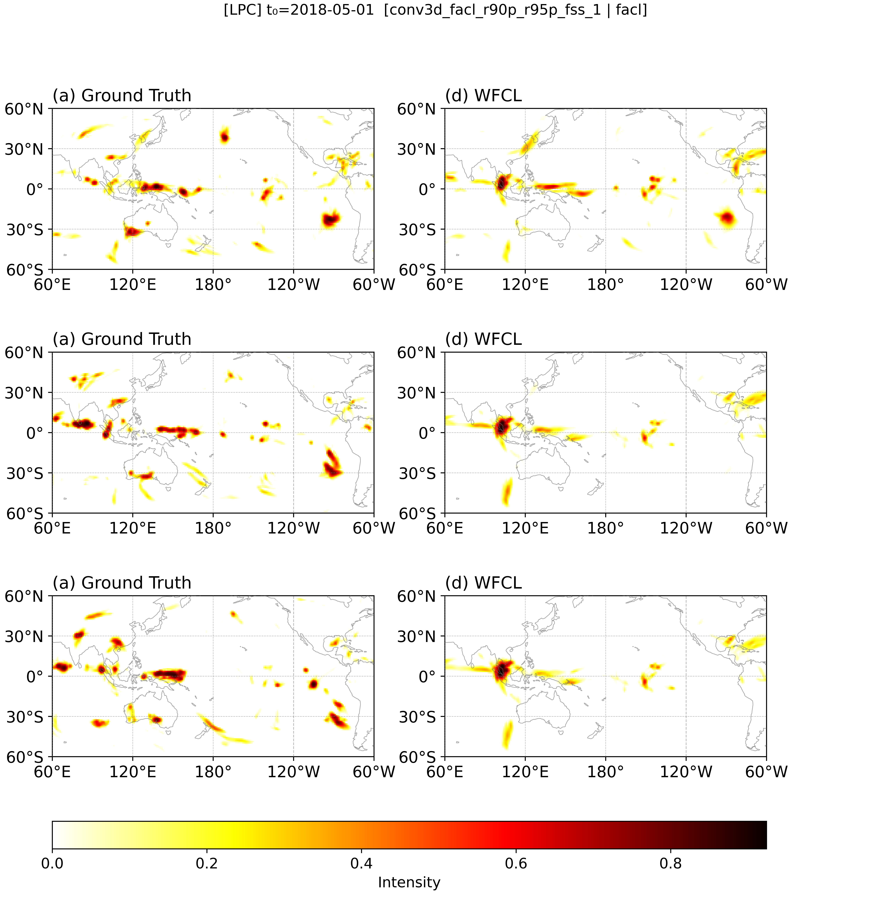
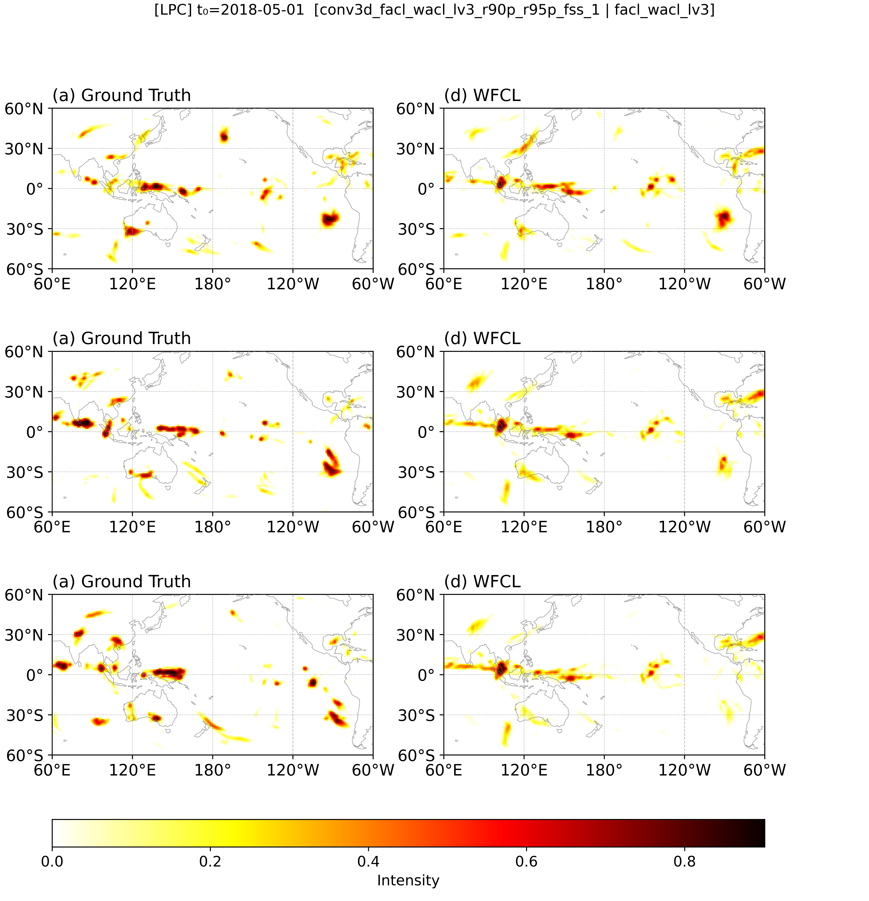
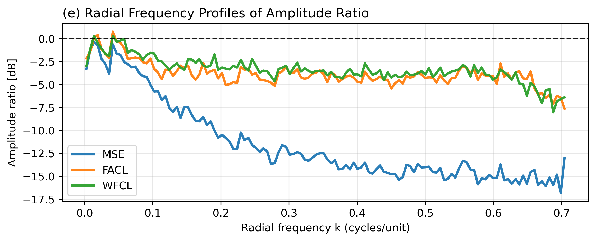
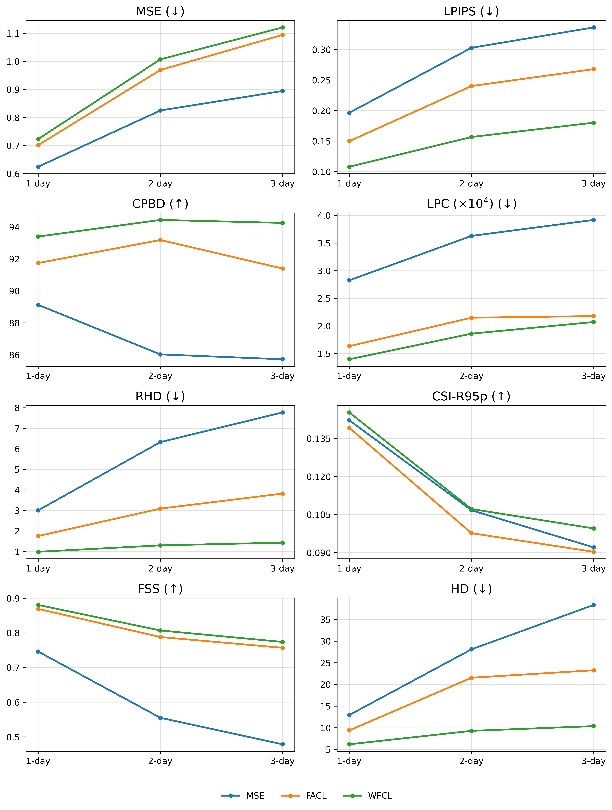
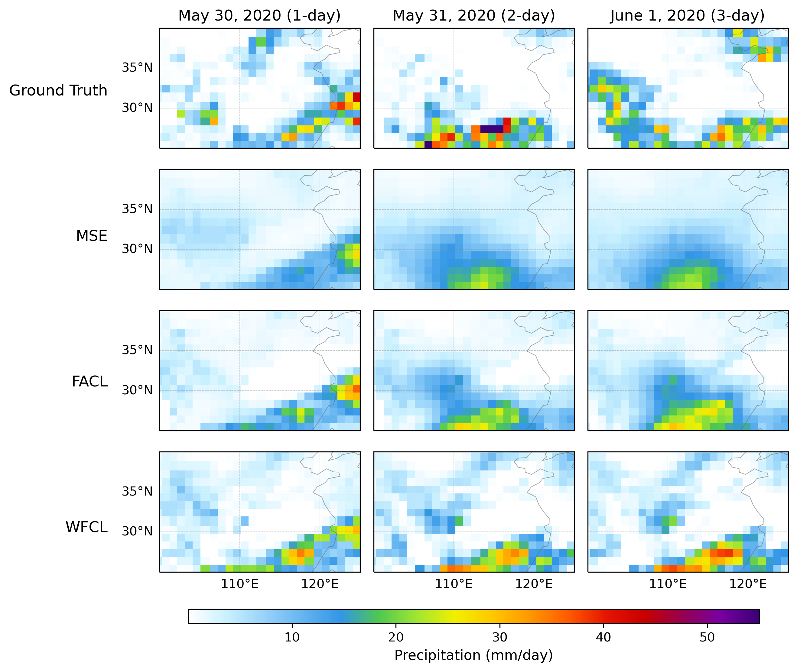

# Toward Spatially Sharper Precipitation Prediction via Global-Local Frequency Guidance

Code for the **Wavelet-Fourier Composite Loss (WFCL)**. WFCL combines the global Fourier Amplitude and
Correlation Loss (FACL) with a local **Wavelet Amplitude and Correlation Loss (WACL)** built on the
Dual-Tree Complex Wavelet Transform (DTCWT). Together they enforce global spectral consistency and local
phase coherence in data-driven daily precipitation forecasts.

A geocyclic U-Net predicts global precipitation 1–3 days ahead from ERA5 precipitation (Pr) and
lower-tropospheric specific humidity (Q<sub>low</sub>, 1000/850 hPa). Only the loss function changes
between experiments: MSE, FACL, or WFCL.

## Method

$$\mathcal{L}_{total} = \beta\,\mathrm{FACL}(X,\hat X) + \sum_{L=1}^{J}\frac{\gamma_L}{6}\sum_{k=1}^{6}\mathrm{WACL}^{(L,k)}(X,\hat X)$$

- **FACL** = FAL (Fourier amplitude) + FCL (Fourier correlation, phase) on the 2D spatial FFT.
- **WACL** = (1 − P<sub>t</sub>)·WAL + P<sub>t</sub>·WCL. It is computed on the 6 directional high-frequency
  DTCWT sub-bands (±15°, ±45°, ±75°) at each level; the low-pass band is excluded.
- P<sub>t</sub> = max(0, 1 − t / ((1 − α)T)) with α = 0.1, which shifts the weight from phase to amplitude over training.
- β = 1, γ<sub>L</sub> = 1, J = 3 (final model: **WFCL Level 3**).

Implementation: [`losses/loss_3d/losses.py`](losses/loss_3d/losses.py) (`facl_wacl_lv{1,2,3}`).

## Results (test set 2018–2023)

**Table 1 | 1-day lead time**

| Loss | MSE ↓ | LPIPS ↓ | CPBD ↑ | LPC (×10⁴) ↓ | RHD ↓ | CSI-R95p ↑ | FSS ↑ | HD ↓ |
|---|---|---|---|---|---|---|---|---|
| MSE | **0.6246** | 0.1964 | 89.13 | 2.82 | 3.01 | 0.1422 | 0.7461 | 12.95 |
| FACL | 0.7017 | 0.1498 | 91.74 | 1.63 | 1.75 | 0.1392 | 0.8691 | 9.40 |
| **WFCL** | 0.7234 | **0.1079** | **93.39** | **1.39** | **0.98** | **0.1453** | **0.8805** | **6.19** |

**Table S1 | DTCWT decomposition level (1-day lead time)**

| Loss | MSE ↓ | LPIPS ↓ | CPBD ↑ | LPC (×10⁴) ↓ | RHD ↓ | CSI-R95p ↑ | FSS ↑ | HD ↓ |
|---|---|---|---|---|---|---|---|---|
| WFCL Lv1 | 0.7201 | 0.1337 | 92.26 | **1.24** | 1.62 | 0.1426 | 0.8687 | 8.48 |
| WFCL Lv2 | 0.7220 | 0.1093 | 92.82 | 1.30 | 1.11 | 0.1424 | **0.8815** | 6.74 |
| WFCL Lv3 | 0.7234 | **0.1079** | **93.39** | 1.40 | **0.98** | **0.1453** | 0.8805 | **6.19** |

All lead times (1–3 days) for every model are in [`tables/metrics_by_leadtime.csv`](tables/metrics_by_leadtime.csv).
FSS uses a 1 mm threshold with a 5×5 window; HD is computed on regions above the 95th percentile.

### Fig. 1 | Perceptual quality (LPIPS map, 1-day lead, base time 2018-05-01)


### Fig. 2 | Precipitation fields (base time 2018-05-01)


Western–Central Tropical Pacific inset. Panels: Ground Truth, MSE, FACL, WFCL; the title of each prediction panel shows its local RHD.


### Fig. 3 | Local phase coherence and spectrum
| MSE | FACL | WFCL |
|---|---|---|
|  |  |  |



### Fig. 4 | Metrics across 1–3 day lead times


### Fig. 5 | Extreme rainfall over the Yangtze River basin (base time 2020-05-29)


### Supplementary
- **Fig. S2** LPIPS maps at 2- and 3-day lead times: [`figures/figS2_lpips_map_leadtime.png`](figures/figS2_lpips_map_leadtime.png)
- **Fig. S4** Tasman Sea / New Zealand event, July 2021: [`figures/figS4_case_tasman_sea_2021.png`](figures/figS4_case_tasman_sea_2021.png)

## Setup

| | |
|---|---|
| Data | ERA5, daily, global 1° (180 × 360), May–September 1979–2023, z-score normalized |
| Inputs | total precipitation (Pr), specific humidity at 850/1000 hPa (Q<sub>low</sub>) |
| Target | precipitation at t+1, t+2, t+3 days |
| Split | train 1979–2015, validation 2016–2017, test 2018–2023 |
| Model | Geo-UNet: two encoder branches with geocyclic padding, 3D conv head for the 3 lead times, 24 base channels |
| Training | Adam, lr 1e-4, batch 16, 80 epochs; checkpoint selected by best validation LPIPS |

### Paper experiments

| Model | Config | Experiment dir |
|---|---|---|
| MSE | [`configs/configs_3d/mse_r90p_r95p/`](configs/configs_3d/mse_r90p_r95p/) | `experiments/subin_an/conv3d_mse_r90p_r95p` |
| FACL | [`configs/configs_3d/facl_r90p_r95p/`](configs/configs_3d/facl_r90p_r95p/) | `experiments/subin_an/conv3d_facl_r90p_r95p` |
| WFCL Lv1 | [`configs/configs_3d/facl_wacl_lv1_r90p_r95p/`](configs/configs_3d/facl_wacl_lv1_r90p_r95p/) | `experiments/subin_an/conv3d_facl_wacl_lv1_r90p_r95p` |
| WFCL Lv2 | [`configs/configs_3d/facl_wacl_lv2_r90p_r95p/`](configs/configs_3d/facl_wacl_lv2_r90p_r95p/) | `experiments/subin_an/conv3d_facl_wacl_lv2_r90p_r95p` |
| WFCL Lv3 | [`configs/configs_3d/facl_wacl_lv3_r90p_r95p/`](configs/configs_3d/facl_wacl_lv3_r90p_r95p/) | `experiments/subin_an/conv3d_facl_wacl_lv3_r90p_r95p` |

The other configs under `configs/configs_3d/` are ablations (Haar DWT sub-band variants, FAL/FCL only,
level weights, MAE). `configs/configs_3d_uv/` adds u/v winds at 850/1000 hPa as inputs.

## Usage

```bash
pip install -r requirements.txt

# train
python main.py --config configs/configs_3d/facl_wacl_lv3_r90p_r95p/facl_wacl_lv3_r90p_r95p.yaml --gpu 0 --task train

# evaluate a checkpoint (set `ckpt:` in the YAML)
python main.py --config configs/configs_3d/facl_wacl_lv3_r90p_r95p/facl_wacl_lv3_r90p_r95p.yaml --gpu 0 --task eval
```

Data, checkpoints and logs are not included. Point `paths.*_file` in the YAML to your own NetCDF files
(`tp`, `q850`, `q1000`; dims `(time, lat, lon)`). The R90p/R95p threshold maps can be generated with
[`threshold_map/threshold_map.py`](threshold_map/threshold_map.py).
Per-metric results are written to `<log_dir>/metrics_by_leadtime_<experiment>.csv`.

## Repository layout

```
main.py                 entry point (train / eval, dispatches on model.version = 2d | 3d | 3d_uv)
train_*.py, evaluate_*.py
configs/                one YAML per experiment
datasets/               NetCDF loading, time split, normalization
losses/loss_3d/         MSE, FACL, WACL/WFCL and ablation losses; registry.py maps config names to functions
models/                 Geo-UNet variants
metrics/                MSE, LPIPS, CPBD, LPC, RHD, CSI, FSS, Hausdorff (metric_utils_3d.py)
figures/                paper figures
tables/                 metrics for all paper models and lead times
sample_wise/, tools/    per-sample evaluation and comparison plots
threshold_map/          R90p / R95p percentile maps
docs/README_ko.md       Korean README with the full YAML schema and extension guide
```

## Citation

An, S., Kim, Y., Cho, D., Ham, Y.-G. *Toward Spatially Sharper Precipitation Prediction via Global-Local
Frequency Guidance* (manuscript).
