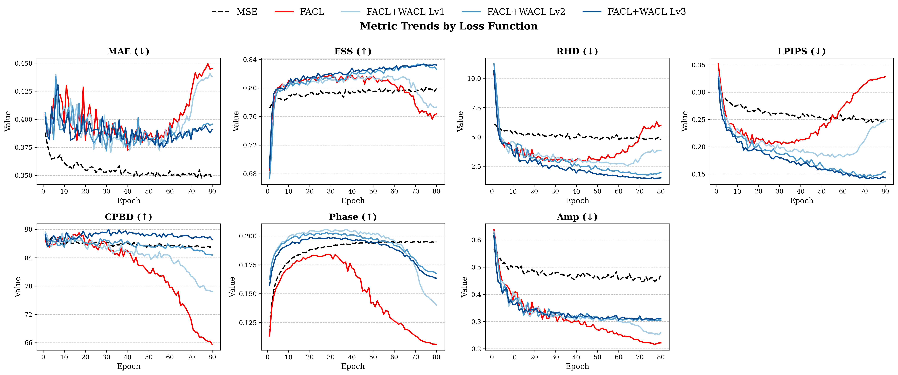

# Spectral & Wavelet Losses for Precipitation Forecasting

A PyTorch framework for comparing **training losses** for data-driven daily precipitation forecasting.
A geocyclic 3D U-Net predicts global precipitation 1–3 days ahead from ERA5 fields. We swap only the loss
function and measure the effect on both pixel accuracy and **structural realism**: sharpness, spatial
spectrum, and extremes.

The central question: plain MSE gives low pixel error but blurry, under-dispersed rain fields. Can
frequency-domain losses fix that, and do they stay stable during training?

## Summary

| Loss | What it does |
|---|---|
| `mse` / `mae` | Pixel-wise baseline |
| `fal` / `fcl` | Fourier **amplitude** loss / Fourier **correlation** loss on the 2D spatial FFT |
| `facl` | FAL+FCL with a stochastic schedule: FCL dominates early, FAL takes over late (Yan et al., NeurIPS 2024) |
| `*_ll`, `*_high`, `wavelet_*` | FAL/FCL applied to Haar DWT sub-bands (low-pass only, high-pass only, all bands) |
| `facl_wacl_lv{1,2,3}` | **FACL + Wavelet amplitude/correlation loss** on complex Dual-Tree CWT sub-bands (6 orientations per level, up to 3 levels) |

**Main result (test set 2018–2023, inputs q/u/v at 850/1000 hPa, mean over lead days 1–3):**

| Loss | MSE ↓ | MAE ↓ | CSI R95p ↑ | FSS ↑ | RHD ↓ | Amp ↓ | LPIPS ↓ |
|---|---|---|---|---|---|---|---|
| MSE | **0.746** | **0.346** | 0.119 | 0.804 | 5.01 | 0.448 | 0.246 |
| FACL | 0.859 | 0.361 | 0.123 | 0.820 | 2.50 | **0.306** | 0.199 |
| FACL + WACL Lv3 | 0.893 | 0.377 | **0.124** | **0.832** | **1.22** | 0.309 | **0.137** |

- **MSE** wins on pixel error, but its fields are blurry. It has the worst RHD (rain-intensity
  distribution), worst spectral amplitude error, and worst LPIPS.
- **FACL** restores spectral amplitude and sharpness. However, it **degrades late in training**:
  once the FAL term dominates (≈ epoch 50+), phase, CPBD, RHD and LPIPS all deteriorate. See the figure below.
- **Adding the DT-CWT wavelet term (WACL)** stabilizes FACL. With 2–3 decomposition levels it gives the
  best FSS, RHD and LPIPS throughout training. The cost is a moderate increase in MSE/MAE relative to MSE.



More comparisons are in [`metrics_comparison_png/`](metrics_comparison_png/): Fourier vs wavelet variants,
sub-band ablations, MAE/phase variants, and level weights. Wavelet filter visualizations are in [`kernel/`](kernel/).

## Setup

| | |
|---|---|
| Data | ERA5, daily, global 1° (180 × 360), May–September 1979–2023 |
| Inputs | specific humidity q850, q1000 (`3d`); + winds u/v at 850/1000 hPa (`3d_uv`) |
| Target | total precipitation at t+1, t+2, t+3 days (`label_offsets: [1, 2, 3]`) |
| Split | train < 2016, validation 2016–2017, test 2018–2023 |
| Model | Geo-UNet: 3D conv U-Net with geocyclic padding (longitude wrap, pole-crossing latitude pad), 24 base channels |
| Training | Adam, lr 1e-4, batch 16, 80 epochs; best checkpoint saved per validation metric |

### Metrics
`mse`, `mae`, `csi_r90p` / `csi_r95p` (critical success index at the local 90th/95th percentile),
`fss` (fractions skill score), `rhd` (patch-wise KL divergence of rain-intensity histograms),
`phase` (mean cosine of Fourier phase difference, ↑), `amp` (Fourier amplitude MSE),
`lpips`, `cpbd` (blur-based sharpness, ↑), plus phase-congruency and Hausdorff distances.

## Usage

```bash
pip install -r requirements.txt

# train (3D, inputs q + u/v)
python main.py --config configs/configs_3d_uv/facl_wacl_lv3/<config>.yaml --gpu 0 --task train

# evaluate a checkpoint (set `ckpt:` in the YAML)
python main.py --config configs/configs_3d_uv/facl_wacl_lv3/<config>.yaml --gpu 0 --task eval
```

Data files are not included. Point `paths.*_file` in the YAML to your own NetCDF files
(`tp`, `q850`, `q1000`, `u850`, `u1000`, `v850`, `v1000`; dims `(time, lat, lon)`).
Per-metric results are written to `<log_dir>/metrics_by_leadtime_<experiment>.csv`.

## Repository layout

```
main.py                 entry point (train / eval, dispatches on model.version = 2d | 3d | 3d_uv)
train_{2d,3d,3d_uv}.py  training loops
evaluate_{2d,3d,3d_uv}.py
configs/                one YAML per experiment (configs_2d, configs_3d, configs_3d_uv)
datasets/               NetCDF loading, time split, normalization
losses/loss_3d/         all losses above; registry.py maps config names to functions
models/                 Geo-UNet variants (2d, 3d, 3d_uv)
metrics/                metric implementations (metric_utils_3d.py)
utils/                  config, logging, checkpoint, seed, GPU/thread pinning
tools/, bar_plot/, sample_wise/, threshold_map/   plotting and analysis scripts
docs/README_ko.md       original (Korean) README with full YAML schema and extension guide
```

## Adding things
- **Loss:** implement it in `losses/loss_3d/losses.py` and register it in `losses/loss_3d/registry.py`.
- **Model:** add it to `models/model_3d*/model.py` and register it in `models/get_model.py`.
- **Metric:** add it to `metrics/metric_utils_3d.py` and enable it under `metrics.names` in the YAML.
